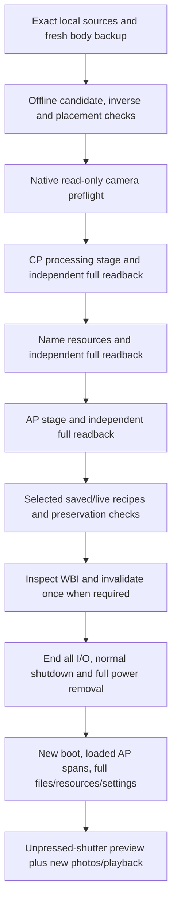

# A7CR research workflow

[English](WORKFLOW.md) · [简体中文](WORKFLOW.zh-CN.md) · [README](../README.md)

This explains the source interfaces and evidence order. It is not a claim that
the published source is a generic stock-to-installed camera application. The
public commands listed in the README have stable host-facing arguments; the
research scripts below include original case paths and must be reviewed for a
new body/workspace. Do not copy a different camera's private package.

## 1. Inputs and source provenance

The native FL23 study used locally acquired official **ILCE-7CR 2.01** and
**ILCE-1M2 4.00** inputs. The six-look port additionally compared **ILCE-7CM2
2.01** AP/CP components. Original containers, decrypted data, components, factory
records and complete program outputs are not included here.

`offline/inspect_sources.py` validates local container checksums and inventories
contents. `offline/extract_components.py` extracts local components. A locally
computed SHA-256 is a reproducibility guard, not a Sony-published authenticity
signature; these scripts do not verify a Sony signing key. Their expected local
input directories are visible at the top of each script.

Use `python a7cr.py bootstrap --research` and `requirements-research.txt` for
the pinned analysis/build dependencies. Keystone 0.9.2 required an arm64 shared
library build on the recorded M4 Pro, using the fixed official Keystone source
and CMake. Installing a Python wheel alone does not establish that its native
library supports this architecture. Keep builds inside `private/`; do not
replace system libraries. Follow the pinned source's build instructions and
verify a trivial ARM/ARM64 assembly before producing a real candidate.

| Source interface | Purpose | Local output category |
|---|---|---|
| `inspect_sources.py`, `extract_components.py` | Inspect/decrypt/extract user-provided inputs | Containers/components/manifests under `private/` |
| `analyze_body_backup.py`, `color_plan.py` | Inspect this body's Backup structures; construct selected-record merges | Private calibration/transition plans |
| `build_fl23_candidate.py` | Build and simulate exact-source native FL23 changes | AP/CP candidates and inverse windows |
| `build_lut_candidate.py`, `audit_lut_storage.py`, `audit_lut_bootstrap.py` | Port six-slot runtime and audit mapped/loading/branch ownership | Private program candidates and audits |
| `build_native_workers.py`, `check_native_workers.py` | Compile native transactions and simulate failure/inverse paths | Per-job native modules, never release payloads |
| `build_resource_mirror.py`, `check_resource_mirror.py` | Checked padded-copy reader for the observed one-file boundary | Local temporary-reader module and simulation evidence |

Several historical constants refer to `20261020-*` case directories. Those are
relative research case names, not a public package supplied to new users.
Preparation requires a fresh backup, new body binding, source checks and native
preflight. Renaming a case path or removing a guard is not enough.

## 2. Read a fresh body-bound checkpoint

Use the explicit backup command in the README. It reads the camera's current
AP/CP and checksum-valid live/saved Backup snapshots, then extracts the four
protected CP units. It does not replace them with donor-body calibration.

The original FL23 backup has two independently verified copies. The later
six-look checkpoints use shared compressed foundations plus per-checkpoint
increments, implemented with upstream backup-store code. These formats must
remain independently reconstructable; a small checkpoint JSON alone is not a
complete backup. In this case both stores were on the same Mac volume, so no
separate-physical-drive resilience was established.

Settings preservation covers writable AP group `02cf` and four protected CP
units (`00`, `01`, `02`, `0d`). Other complete snapshots are retained as evidence.
Unrelated changing telemetry is not a write target. Known AP diagnostic value
`02cf0b6e` is treated separately from writable user settings. In native FL23,
ordinary bindings `02cf1287` / `02cf1289` differ from MR counterparts `1288` /
`128a`; do not overwrite the MR fields as an alias.

## 3. Keep the processing paths distinct

Native FL2/FL3 use AP selection/metadata/defaults plus CP gamma, chroma and matrix
dispatch. On this adaptation photo modes19/20 map to parameters55/56 and gamma
rows48/49. Donor look records are merged into the appropriate records; unrelated
per-body data remain this camera's own. Current user adjustments are separate
from factory/reset defaults.

The six imported looks use signed correction tables over **ST**, not native
FL2/FL3's processing records. Each raw table is `5 x 9 x 9 x 3 = 1215` bytes,
signed values -64..63. The hardware upload representation is different; raw
planes must not be copied into a hardware-bank address. The original native LUT
builder performs that conversion in the port. Selected slots use markers249–254
only under base ST; the base selector remains editable.

The six experiment selections were Classic Neg., Classic Chrome, Nostalgic Neg.,
Eterna, GR Positive Film and GR Negative Film. Their source DCPs came from the
upstream 18-profile attachment. This repository ships none of those profiles or
derived tables. The shared DCP bridge was the upstream one-scene A7C II model;
it is not an A7CR color characterization or a complete Adobe renderer.

## 4. Stages and completion criteria

FL23 and six-look transitions have different selected windows/records. The
diagram shows dependencies rather than an interchangeable installer. Preserve
the source and inverse manifest for the actual transition.

The host orchestration is in `device/preflight_fl23.py`, `fl23_install.py`,
`prepare_six_luts.py`, `install_six_luts.py`, and the narrowly scoped completion /
inspection modules. Native workers check expected complete program identities,
edited-byte windows, file ownership/mount state and receipt status; the host
independently reads complete outputs. Names, settings and WBI are separate
transactions.

For six names, 68 locale/orientation resources are handled. Original hardlinks
are retained until physical acceptance and post-reload checks. Cleanup is not
permission to reinstall or silently restore stale settings.

## 5. An interrupted phase is not a retry request

The observed six-look case completed CP and name writes, then stopped during
host readback of a name resource. AP, recipe and WBI stages had not yet run.
Inspection classified this exact state before AP-only completion; CP and names
were not rewritten. The source includes checks that reject a different failed
attempt, missing receipts, later write intents, wrong body or unexpected data.

The one boundary resource was `string_croatian_vertical.uxc`: the updated file
was 119,292 bytes; adding the four-byte response status made 119,296 bytes, an
exact 512-byte multiple. The vendor reader requested an additional final packet.
A separate native reader copied the known size/hash/owner-checked source into
an owned temporary file with one sentinel byte. The ordinary parser then read
that copy; the complete original bytes were compared again. The original
resource and generic timeout behavior were not changed. This does not establish
that all USB failures have that cause.

Service entry is another phase. During re-enumeration do not select MSC again
until the reads-ended message. One failed entry followed such a selection and a
later correctly timed session worked; this is not proof of a universal hardware
or user-action explanation for service timeouts.

## 6. Reload and physical acceptance

Only after all I/O has ended: disconnect USB/external power, shut down normally,
wait for the access lamp to stop, remove the battery for at least 60 seconds,
then reinstall it and start the camera. Do not repeat program writes to force a
reload. A retained WBI can otherwise restore an older runtime; mode inspection
must precede the one-shot transition, and mode0 is not a reason to repeat it.

For native FL23, check newly reset defaults separately. The upstream A7CR notes
derive factory defaults `0,0,0,1,0,4,3,1`; this is static firmware evidence rather
than readings from a physical Alpha 1 II. Current values may be intentionally
different and must not be silently reset by a verifier.

For each imported slot, check immediate preview **before pressing the shutter**,
fresh photo/playback, visible name, selected base and original looks. Test in
ordinary P/A/S/M first; an earlier MR selection had obscured the effect in this
case. A new photo, not an old photo, is needed to validate changed metadata.

`device/verify_six_luts.py` supports a machine-only pass first. Its loaded-runtime
reader checks16 actual AP file/memory spans and a new boot, plus complete disk
programs/resources/settings. It does not directly dump running CP instructions
or tables. `--physical-accepted` additionally cleans owned old resource links
and is reserved for actual owner-confirmed acceptance of all required physical
checks; it must not be inferred from byte readback or a native FL2 photo alone.

## 7. Recovery and limits

Keep a failed journal and temporary artifacts. Never re-authenticate or replay a
write after an unknown result merely to see whether it works. Classify current
state and receipts, then use only a supported exact inverse/continuation.
Unrelated current user changes must be preserved rather than rolled back from
old snapshots.

Software inverse and syscall-failure simulations exist, but complete physical
restoration / memory-card recovery after arbitrary CP damage was not tested.
The public release intentionally makes no such recovery guarantee.
