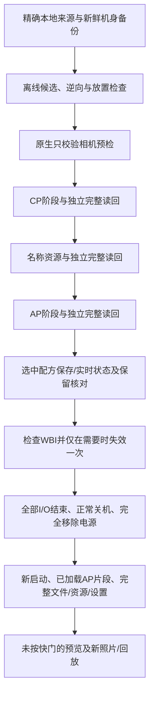

# A7CR 研究流程

[English](WORKFLOW.md) · [简体中文](WORKFLOW.zh-CN.md) · [首页](../README.zh-CN.md)

本文解释源码接口及证据顺序，不代表公开源码已经是一套适用于任意原厂机身的
完整安装应用。首页列出的公开命令具有固定参数；研究脚本仍包含原始任务路径，
用于新机身／工作目录前需要逐项审核。不能使用另一台相机的私人安装包。

## 1. 输入与来源

原生 FL23 研究使用本地取得的官方 **ILCE-7CR 2.01** 与 **ILCE-1M2 4.00**。
六槽适配还比较了 **ILCE-7CM2 2.01** 的 AP／CP。原始固件包、解密数据、组件、
原厂色彩记录和完整程序输出都不在公开仓库中。

`offline/inspect_sources.py` 校验本地容器校验和并列出内容，
`offline/extract_components.py` 提取本地组件。SHA-256 是本地复现／来源约束，
不是 Sony 公布的真实性签名；这些脚本不验证 Sony 签名密钥。预期的本地输入
目录在各脚本开头明确列出。

运行 `python a7cr.py bootstrap --research` 并安装 `requirements-research.txt`
可准备固定的分析依赖。本次 M4 Pro 上，Keystone 0.9.2 的共享库由固定官方源码
和 CMake 编译为 arm64；安装 Python wheel 并不证明其中原生库支持当前架构。
构建产物留在 `private/`，不替换系统库。原生构建请遵循固定源码的构建说明，
在生成实际候选前先核对简单 ARM／ARM64 汇编。

| 接口 | 用途 | 本地输出 |
|---|---|---|
| `inspect_sources.py`、`extract_components.py` | 检查、解密、提取使用者提供的输入 | `private/` 中的容器、组件和清单 |
| `analyze_body_backup.py`、`color_plan.py` | 检查本机 Backup，构建选中记录合并计划 | 私人校准／变换计划 |
| `build_fl23_candidate.py` | 构建并模拟精确来源的原生 FL23 变更 | AP／CP 候选、逆向窗口 |
| `build_lut_candidate.py`、`audit_lut_storage.py`、`audit_lut_bootstrap.py` | 六槽移植、映射／加载／分支边界审计 | 私人程序候选和审计 |
| `build_native_workers.py`、`check_native_workers.py` | 原生交易模块及失败／逆向模拟 | 逐任务原生模块，不作为发布载荷 |
| `build_resource_mirror.py`、`check_resource_mirror.py` | 特定边界文件的已核验填充副本读取 | 本地临时读取模块与模拟证据 |

部分历史常量引用 `20261020-*` 目录。这些只是相对的研究案例名称，不是随项目
提供给新用户的安装包。重新准备要求新鲜备份、本机绑定、来源核对和原生预检；
仅修改日期目录或移除检查并不构成准备完成。

## 2. 新鲜且绑定本机的检查点

按首页公开命令读备份，取得当前 AP／CP 与校验有效的实时／保存 Backup 快照，
再从快照提取四个 CP 保护单元，不以捐赠机的整份校准代替。

原生 FL23 最初备份有两份独立核验副本；后续六槽检查点使用上游的压缩共用基础
与逐次增量。每份都须能独立重建完整内容，不能只保留很小的检查点 JSON。
本次两套存储实际在同一块 Mac 卷上，因此没有建立独立物理磁盘容灾能力。

设置保留核对涵盖可写 AP 组 `02cf` 与四个 CP 单元 `00/01/02/0d`。其他完整快照
保留为证据，不把会变化的无关运行遥测当成写入目标。已知 AP 诊断值 `02cf0b6e`
与可写用户设置分开处理。原生 FL23 普通绑定 `02cf1287`／`02cf1289` 与 MR 对应
字段 `1288`／`128a` 不同，不能当作别名覆盖。

## 3. 区分两种图像处理路径

原生 FL2／FL3 通过 AP 选择／元数据／默认值，以及 CP 伽马、色度、矩阵调度实现。
本适配中照片模式19/20分别映射参数55/56与伽马48/49。只将对应外观记录合并到
目标记录，其他本机数据保留。当前用户调整值与工厂重设默认值是不同的状态。

六个导入外观则是叠加在 **ST** 上的有符号修正表，不走原生 FL2／FL3 的外观记录。
每张原始表 `5×9×9×3 = 1215` 字节，系数 -64～63。硬件上传表示不同，不能把
原始平面直接写进硬件 bank 地址；本移植仍由原生 LUT 构建器完成对应转换。
选中槽只在实际基础外观为 ST 时使用249～254标记，基础外观选择器没有锁定。

本次选了经典负片、经典正片、怀旧负片、Eterna、GR 正片、GR 负片，来源是上游
18 款原始 DCP 附件。本仓库不分发这些文件或衍生表。所用共享桥接模型来自上游
单场景 A7C II，不是 A7CR 色彩标定，也不是完整 Adobe 显影管线。

## 4. 阶段与验收顺序

FL23 与六槽变换的选中窗口／记录不同，上图表达依赖关系，不代表两者可以互换
安装器。始终保留实际变换的来源及逆向清单。

主机编排主要在 `device/preflight_fl23.py`、`fl23_install.py`、
`prepare_six_luts.py`、`install_six_luts.py` 与限定用途的检查／收尾模块。
原生模块核对完整程序身份、实际修改窗口、文件归属／挂载和结果回执；主机随后
独立完整读回。名称、设置与 WBI 是分开的交易。

六槽名称涉及 68 份语言／方向资源。原文件硬链接保留到实拍接受及重载核验，
清理旧链接并不允许重新安装，也不允许静默恢复旧的无关用户设置。

## 5. 阶段中断不等于应重试

本次六槽案例已完成 CP 与名称写入，之后在主机读取名称资源时停止，AP、配方、
WBI 仍未执行。先检查并分类这一精确状态，再只收尾 AP 及其后依赖，没有重复
写入 CP 或名称。源码会拒绝其他失败批次、缺失回执、后续写入意图、错误机身
或不符合预期的数据。

边界文件为 `string_croatian_vertical.uxc`：更新后119,292字节，加4字节状态后的
响应119,296字节恰好为512的整数倍，读取器在末尾要求额外一个包。
单独原生读取器核对已知大小、哈希及属主，再复制到带一个哨兵字节的自有临时文件；
普通解析器读取临时副本，随后完整核对原始内容。没有重写原资源，也没有放宽
通用超时规则。这并不证明所有 USB 故障都由此引起。

服务模式进入是另一阶段。重新枚举期间不要提前选择 MSC。一轮失败发生在手动
点选之后，后续按阶段等待的会话成功；这不能证明所有服务超时都是硬件或用户
操作造成的。

## 6. 重载和实拍验收

仅在全部 I/O 已结束后：拔除 USB／外部电源、正常关机、等待存取灯熄灭、取出
电池至少60秒，再装回开机。不能靠重复刷写强行重载。保留启动镜像可能恢复旧
运行状态，须先检查 WBI 模式，再在需要时做一次对应转换；已处于 mode0 不应重跑。

原生 FL23 的工厂默认值需另行检查。上游 A7CR 文档从固件静态记录推导出
`0,0,0,1,0,4,3,1`，这不是实体 Alpha 1 II 菜单读取结果。当前用户值可能有意不同，
核验器不能静默重设。

每个导入槽分别检查**未按快门时**的即时预览、拍摄新照片／回放、可见名称、实际
基础外观与原有外观。先用普通 P/A/S/M；本次早期 MR 档曾掩盖效果。元数据修正
需通过修正后新拍文件验证，旧照片不会自动变化。

`device/verify_six_luts.py` 可先做机器核验：读取16个实际 AP 文件／内存片段及新
启动标识，再核对完整程序、资源与设置。没有直接转储运行中的 CP 指令或表。
`--physical-accepted` 会进一步清理自有旧资源链接，只能用于机主确实完成所有
必要实拍检查的情况；不能从文件读回或一张原生 FL2 照片推断六槽验收完成。

## 7. 恢复边界

保留失败日志与临时产物。未知结果后不能为了试试看而重新认证或重放写入；
先核对当前状态和回执，再使用支持的精确逆向／收尾。不能从旧快照回滚用户后来
修改的无关设置。

已有软件逆向与系统调用失败模拟，但没有验证任意 CP 损坏后的完整实机还原或
存储卡恢复。公开版本不作这类恢复保证。
